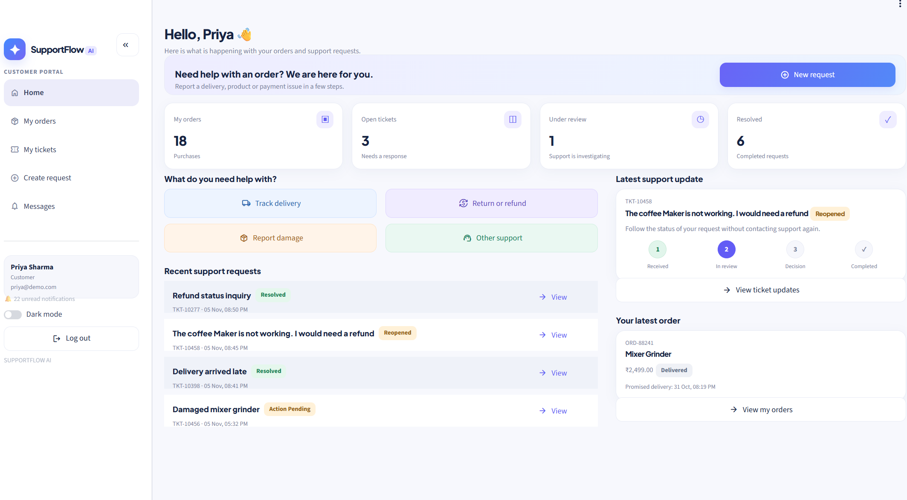
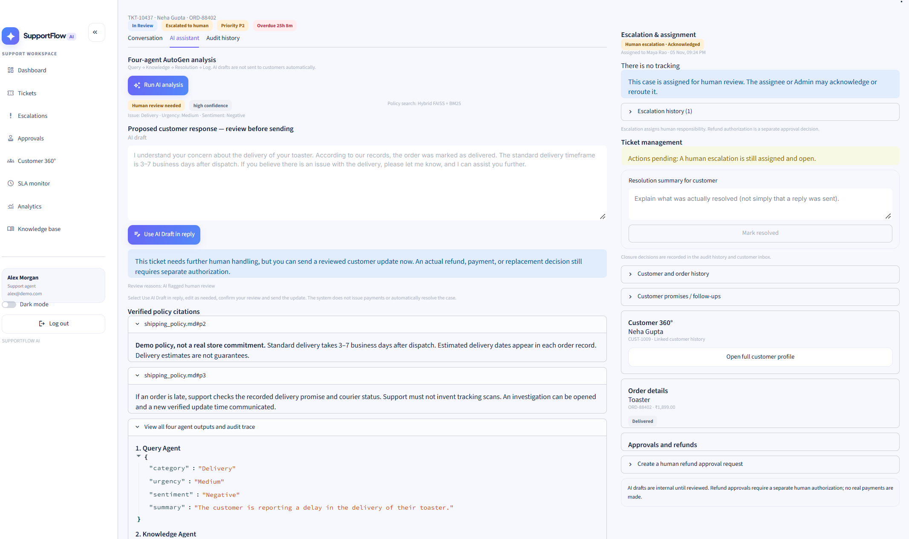
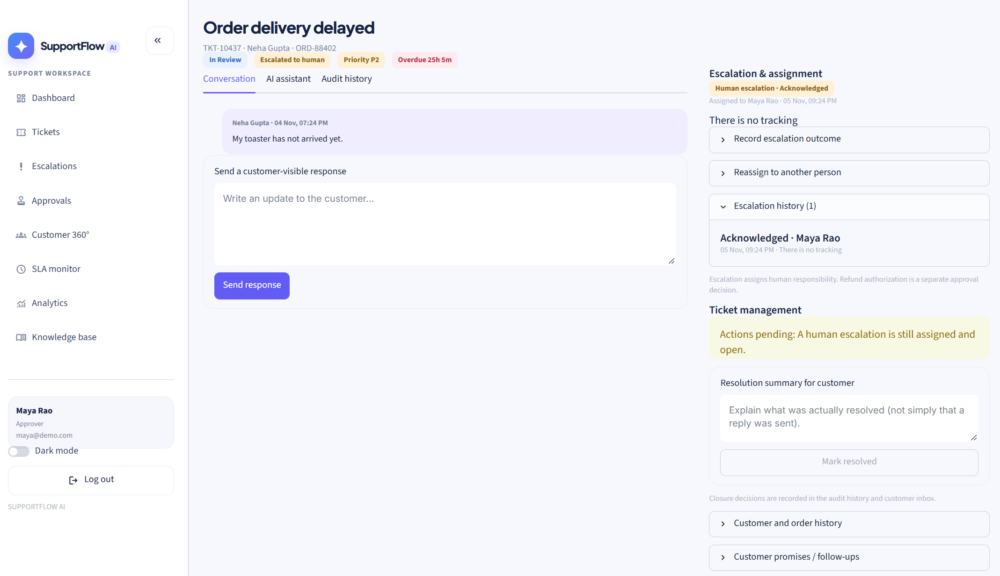
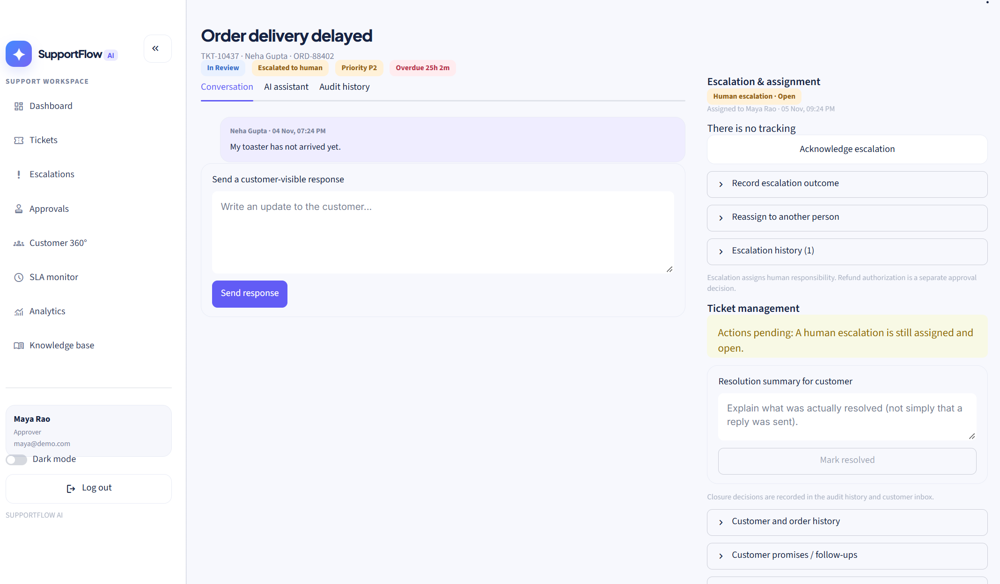
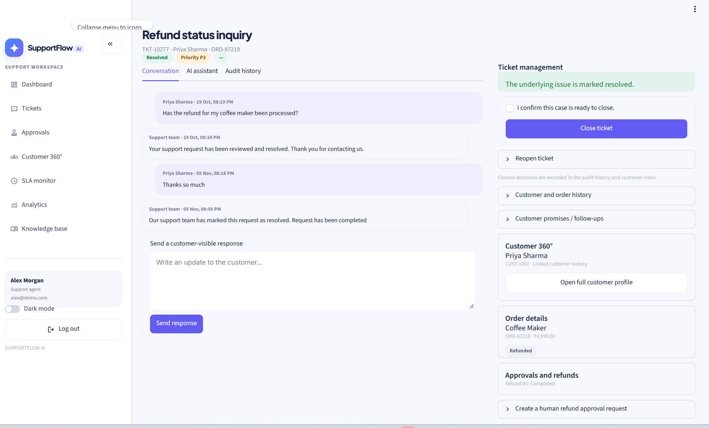
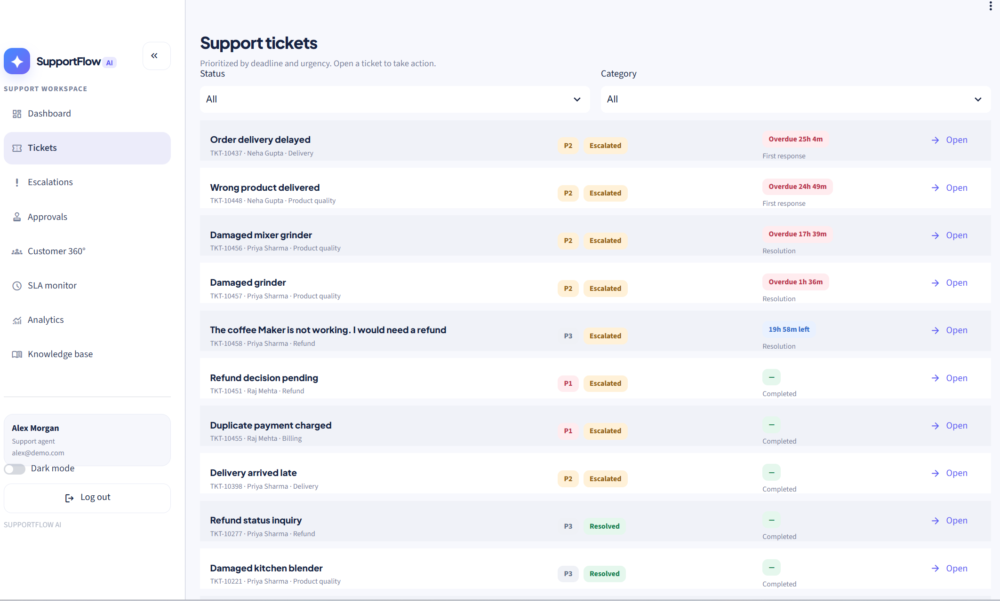

# SupportFlow AI — Customer Support Automation

**An AutoGen-powered customer support desk with policy-grounded answers, human approval, named-person escalations, customer history, and SLA monitoring.**

> **Submission / demo project.** This application uses simulated orders and refunds. It is not a production-ready payment, identity, or customer-service platform.

## Overview

SupportFlow AI helps an e-commerce support team classify customer complaints, retrieve verified company policies, draft appropriate responses, and escalate sensitive cases for human review. Customers can create tickets and track replies in a dedicated portal; staff can work from an operational ticket queue, see previous customer interactions, review AI drafts, and follow service deadlines.

The required assignment uses **four AutoGen agents**, **Python**, **Streamlit**, a local **knowledge base**, escalation logic, and an exportable ticket log. This project implements those features and demonstrates several optional enhancements.

## GitHub Repository

The complete SupportFlow AI application, source code,
documentation, tests, and screenshots are available at:

https://github.com/SJaikumar/Supportflow.ai

The repository includes all files required to install,
run, test, and demonstrate the application.

Customer submits complaint → Four AutoGen agents analyze → Support agent reviews → Human escalation or approval when required → Customer receives response → Ticket resolved and closed.

See [GitHub upload instructions](docs/GITHUB_SUBMISSION.md).

## Key features

| Area | Implementation |
| --- | --- |
| Customer portal | Orders, support requests, ticket conversations, photo attachments, status and notifications |
| Support workspace | Prioritized tickets, Customer 360°, AI drafts, policy citations, approval queue and analytics |
| Four AutoGen agents | Query → Knowledge → Resolution → Log (explicit sequential orchestration) |
| Grounded retrieval | Hybrid FAISS semantic + BM25 keyword retrieval, using RRF and source references |
| Escalation | AI-detected risk flags plus staff assignment to a named agent/approver/admin, acknowledgment, reassignment and completion |
| Human-in-the-loop | Agents can review and edit informational replies; authorized approvers handle refund decisions |
| Records | SQLite/SQLAlchemy storage for tickets, orders, messages, approvals, refunds and audit history |
| SLA monitoring | Separate worker for first-response and resolution thresholds, alerts, follow-up commitments |
| Photo inspection | Optional, consent-based AI analysis of customer product images; no automatic refund decisions |
| Ticket lifecycle | Staff can mark resolved, close and reopen tickets; unresolved human assignments and outstanding actions prevent premature closure |
| Logging | Persistent tickets and agent traces; exportable ticket log (CSV) |
| Theme | Light-first Streamlit UI with an optional dark mode |


## Application Screenshots

The following screenshots demonstrate SupportFlow AI's main features, including the customer portal, AI-assisted ticket resolution, human approval, escalation management, and ticket logging.

### 1. Customer Dashboard


### 2. Support Agent Dashboard


### 3. Four-Agent AI Analysis


### 4. Human-in-the-Loop Approval


### 5. Escalated Ticket


### 6. Resolved Ticket


### 7. Ticket Log



## Architecture

```text
Streamlit app (app.py)
├── Customer and agent views
├── SQLite / SQLAlchemy (supportflow/db.py, models.py, services.py)
├── AutoGen agent orchestration (supportflow/ai/pipeline.py)
│   ├── Query Agent — issue category, urgency, sentiment
│   ├── Knowledge Agent — company policy search with citations
│   ├── Resolution Agent — verified customer reply draft
│   └── Log Agent — structured logging and escalation recommendation
├── Policy retriever (supportflow/ai/retrieval.py)
│   └── BM25 + FAISS + Reciprocal Rank Fusion
├── Approval, refund and notifications workflow
├── SLA/background worker (supportflow/worker.py)
└── Optional photo observations (supportflow/photo.py)
```

The Python application runs each AutoGen agent in an explicit sequence; it does **not** rely on a live group-chat router. Database writes, sending messages, refund simulation, and approval enforcement are controlled by deterministic application services. See [Architecture](docs/ARCHITECTURE.md).

## Tech stack and Python dependencies

- **Language:** Python 3.11 recommended
- **UI:** Streamlit
- **Agent framework:** `autogen-agentchat`, `autogen-ext[openai]`
- **LLM / embeddings / vision:** OpenAI API (model names set by `.env`)
- **Database:** SQLite with SQLAlchemy
- **Search:** FAISS, NumPy, BM25-style lexical ranking
- **Image handling:** Pillow
- **Data and export:** pandas
- **Environment / tests:** python-dotenv, pytest

The authoritative list of Python package versions/ranges is **[`requirements.txt`](requirements.txt)**. Do not upload locally installed `site-packages` or your `.venv` directory.

## Human Escalation and Assignment

Staff can now explicitly escalate a ticket to another authorized person, provide a reason, and track ownership.
From **All Tickets**, choose **Escalated** to find AI-flagged cases. Open a ticket and use **Escalation & assignment** to assign it to Maya or Admin. The assignee can acknowledge, reassign, and complete the handoff. An unfinished handoff blocks manual ticket closure, and refund approval remains a separate restricted action.

See [Escalation and ticket lifecycle](docs/ESCALATION_AND_TICKETS.md) for role permissions and the complete demonstration flow.

## Installation (Windows PowerShell)

1. Clone this repository or download its source ZIP.
2. Open the folder containing `app.py` in VS Code.
3. For Windows, prefer a short path, such as `C:\SupportFlow` (avoids long-path dependency installation errors).

```powershell
cd C:\SupportFlow
py -3.11 -m venv .venv
.\.venv\Scripts\Activate.ps1
python -m pip install --upgrade pip
python -m pip install -r requirements.txt
Copy-Item .env.example .env
```

Open `.env` and add your own **OpenAI API key**, if you want to run live AI analysis:

```ini
OPENAI_API_KEY=your_key_here
SUPPORTFLOW_AI_MODEL=gpt-4o-mini
SUPPORTFLOW_EMBEDDING_MODEL=text-embedding-3-small
SUPPORTFLOW_VISION_MODEL=gpt-4o-mini
```

**Never commit `.env`, an API key, real customer data, local database files, or uploaded photos.** The interface and simulated ticket workflows can be demonstrated without a key, but live AI analysis/photo inspection cannot.

### Start the Streamlit UI (Terminal A)

```powershell
python -m streamlit run app.py
```

Visit <http://localhost:8501>.

### Start the deadline worker (Terminal B)

Use a second VS Code terminal with the same virtual environment activated:

```powershell
python -m supportflow.worker --interval 60
```

One-time SLA check:

```powershell
python -m supportflow.worker --once
```

Optional **simulated** processing of already human-approved refunds (run **instead of** the standard worker):

```powershell
python -m supportflow.worker --interval 60 --auto-refunds
```

Do not run two workers against the same demo SQLite database simultaneously. Portal notifications do not send email/SMS/WhatsApp messages.

## Demo accounts

Demo login accounts are seeded for local presentation; the sign-in screen does not show their credentials. These credentials are public **test-only** values—do not deploy them to the internet.

| Role | Email | Password |
| --- | --- | --- |
| Customer | `priya@demo.com` | `Demo123!` |
| Customer | `raj@demo.com` | `Demo123!` |
| Support agent | `alex@demo.com` | `Demo123!` |
| Approver | `maya@demo.com` | `Demo123!` |
| Administrator | `admin@demo.com` | `Demo123!` |

For a guided end-to-end presentation, see [Demo Guide](docs/DEMO_GUIDE.md).

### Closing or reopening a ticket

Log in as Alex or another support user, open **All tickets → Open**, and find **Ticket management** at the top of the ticket details right-hand panel. Active tickets can be marked **Resolved** with a factual resolution summary. Once resolved, select **Close ticket** and confirm. For resolved/closed tickets, open **Reopen ticket** and enter a reason. Pending human approvals, in-progress refunds, and incomplete customer promises prevent manual resolution or closure. The customer is notified in the portal, and a reply to a closed ticket reopens it automatically. See [Ticket lifecycle](docs/TICKET_LIFECYCLE.md).

## Knowledge base

The locally supplied sample policies live in `knowledge_base/`:

- `shipping_policy.md`
- `refund_policy.md`
- `account_and_login.md`
- `product_faq.md`

The policy documents are **fictional demo company rules**. The AI must not invent additional policy, tracking details, approval outcomes or refund completion.

## Testing

```powershell
python -m pytest -q
```

Offline tests cover ticket closure/reopening, ticket and refund workflows, agent orchestration contracts, citations, escalation, SLA events, permissions, image consent, and reply-review safeguards. See [Test Scenarios](docs/TEST_SCENARIOS.md) for expected behavior and manual checks.

**Release test result:** All **63 offline tests passed** on this Stage 4.6 submission package (2026-11-05). This does **not** establish that your local browser layout or live OpenAI calls succeed. Re-run the tests and capture screenshots from your own running application before submitting.

## Submission Evidence

The repository includes screenshots demonstrating:

- Customer and Support Agent Dashboards
- Four-Agent AutoGen Analysis with Policy Citations
- Human-in-the-Loop Approval
- Human Escalation and Assignment
- Resolved Customer Support Ticket
- Ticket Log with Complaint History and Escalation Details

All screenshots are available in the
[screenshots](screenshots/) folder.

## Known limitations and safety

- Designed as a local assignment demonstration with **simulated** orders/refunds, not a connected payment processor or courier.
- Demo credentials are seeded in source and are **not** suitable for public deployment.
- SQLite and the background worker are intended for low-concurrency/local testing.
- Live LLM operations require an OpenAI account, a valid API key, model access, and credits.
- Browser rendering and live model connectivity must be checked locally.
- Uploaded photos can be inspected only with recorded customer consent and staff action; observations do not prove defects.
- Staff review does not itself authorize refunds; human approval is a separate step.
- Real customer records, credentials or payment details must never be put in a public repository.

## Documentation

- [Architecture and data flow](docs/ARCHITECTURE.md)
- [End-to-end demo script](docs/DEMO_GUIDE.md)
- [Assignment test scenarios](docs/TEST_SCENARIOS.md)
- [GitHub submission checklist](docs/GITHUB_SUBMISSION.md)
- [Screenshot instructions](screenshots/README.md)

## Repository layout

```text
app.py
supportflow/         Application, AutoGen, services, database, UI and background worker
knowledge_base/      Four example company policy documents
scripts/             Optional OpenAI connection diagnostic
screenshots/         Application screenshots demonstrating key features
docs/                Architecture, demo, tests and submission checklist
tests/               Automated tests
.streamlit/          Streamlit theme and app configuration
.env.example         Safe environment variable template
.gitignore           Local/secrets exclusions
requirements.txt     Python dependencies
README.md            This guide
```

**Academic assignment:** AI Customer Support Automation (four-agent AutoGen support desk).


